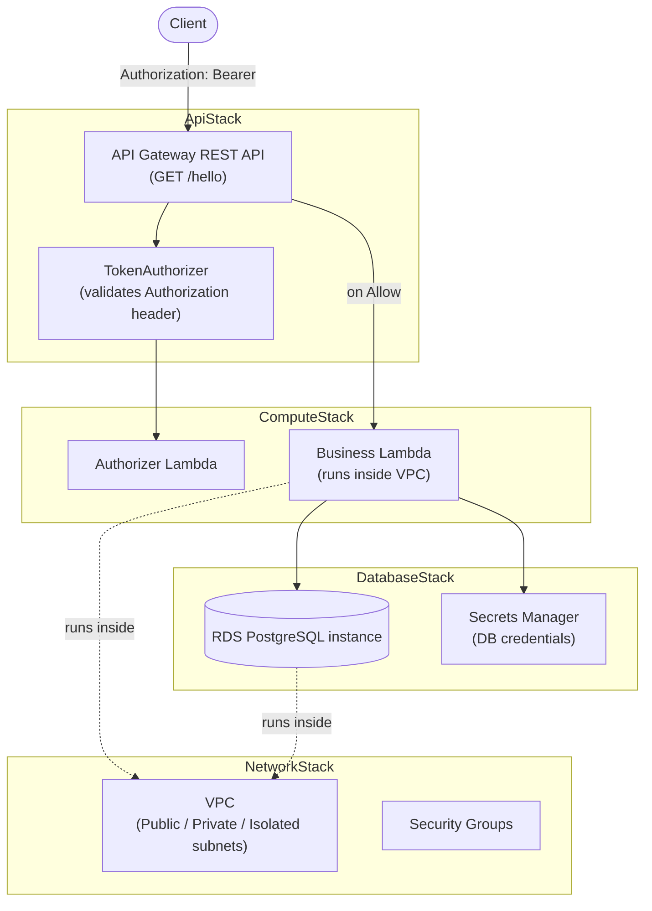

# AWS API CDK

A learning project that provisions a serverless REST API (API Gateway + Lambda) backed by
RDS PostgreSQL, fully defined with the AWS CDK (TypeScript) across four stacks.

## Architecture



### Stacks

| Stack | Resources | Purpose |
|---|---|---|
| `NetworkStack` | VPC (public/private/isolated subnets, 1 NAT gateway), security groups, Secrets Manager VPC interface endpoint | Shared networking foundation for the other stacks |
| `DatabaseStack` | RDS PostgreSQL instance, auto-generated Secrets Manager secret, RDS security group | Application's relational data store |
| `ComputeStack` | Business Lambda (in VPC, queries RDS), Authorizer Lambda (validates requests) | Application logic |
| `ApiStack` | Regional REST API, `TokenAuthorizer`, `GET /hello` method | Public HTTP entry point |
| `WafStack` *(opt-in, not deployed by default)* | Regional WAF Web ACL (`AWSManagedRulesCommonRuleSet`) associated with the API stage | Basic OWASP-style protection for externally-exposed APIs |

Request flow: a client calls `GET /hello` with an `Authorization: Bearer <token>` header.
API Gateway invokes the **Authorizer Lambda** via a `TokenAuthorizer`; if it returns an
`Allow` policy, API Gateway invokes the **Business Lambda**, which reads DB credentials from
Secrets Manager and queries the RDS PostgreSQL instance over the VPC's private subnets.

> **Note:** RDS Proxy was intentionally left out — it isn't available on AWS accounts using
> the free/basic plan. The Business Lambda connects directly to the RDS instance instead.

## Getting the code


```bash
git clone https://github.com/teeru1983/AWS-API-CDK.git
cd AWS-API-CDK
npm install
```

## Prerequisites

- Node.js 18+ and npm
- An AWS account and credentials configured locally (e.g. `aws configure`)
- AWS CDK CLI (invoked here via `npx cdk`, no global install required)
- `cdk bootstrap` run once per AWS account/region (sets up the CDK staging bucket/roles)

## Deploying

```bash
# One-time per account/region
npx cdk bootstrap

# Review generated CloudFormation templates
npx cdk synth

# Deploy all four stacks
npx cdk deploy --all
```

`cdk deploy` prints stack outputs when it finishes, including the API endpoint URL and the
Lambda function names — you'll need these to fill in the Postman collection variables (see
[postman/aws-api-cdk.postman_collection.json](postman/aws-api-cdk.postman_collection.json)).

To remove everything:

```bash
npx cdk destroy --all
```

## Optional: WAF (not deployed by default)

`WafStack` adds a regional AWS WAF Web ACL (AWS Managed Core Rule Set) directly on the API
Gateway stage — no CloudFront required. It's defined in
[lib/waf-stack.ts](lib/waf-stack.ts) but is **not** part of `cdk deploy --all`; `bin/aws-api-cdk.ts`
only adds it to the app when explicitly opted in, since **AWS WAF has no free tier** and bills
from the moment it's created (~$5/month Web ACL + ~$1/month per rule group + $0.60 per
million requests inspected).

```bash
# Deploy
npx cdk deploy WafStack -c enableWaf=true

# Tear down when done, to stop the charge
npx cdk destroy WafStack -c enableWaf=true
```

## IAM roles used, and why

CDK auto-generates most of these roles; only the authorizer's invocation role is created
explicitly in code. None of them are long-lived user credentials — they're all AWS-managed
roles assumed by AWS services at runtime.

| Role | Assumed by | Why it's needed |
|---|---|---|
| Business Lambda execution role | `lambda.amazonaws.com` | Write logs to CloudWatch, create/manage ENIs to run inside the VPC, and read the RDS secret (`grantRead` on the Secrets Manager secret) |
| Authorizer Lambda execution role | `lambda.amazonaws.com` | Write logs to CloudWatch (this Lambda doesn't run inside the VPC, so no ENI permissions needed) |
| `AuthorizerInvocationRole` (defined in `ApiStack`) | `apigateway.amazonaws.com` | Lets API Gateway invoke the Authorizer Lambda. An explicit role (via `assumeRole` on `TokenAuthorizer`) is used instead of the default resource-based Lambda permission, because the default approach would create a circular dependency between `ComputeStack` and `ApiStack` |
| API Gateway method invoke permission (on Business Lambda) | `apigateway.amazonaws.com` | Automatically added by `LambdaIntegration`, scoped to the specific `GET /hello` method so API Gateway can invoke the Business Lambda |

Database credentials are **not** stored in IAM — they live in a Secrets Manager secret that
RDS auto-generates and rotates, and the Business Lambda is granted read-only access to that
one secret.

## Testing

A Postman collection is provided in [postman/aws-api-cdk.postman_collection.json](postman/aws-api-cdk.postman_collection.json),
covering:
- End-to-end calls to `GET /hello` through API Gateway and the authorizer
- Direct Lambda invocations (via the AWS Lambda Invoke API with AWS Signature auth) for both
  the Authorizer Lambda and the Business Lambda, useful for isolating issues

Import the collection, fill in the collection variables with values from your own
`cdk deploy` output (API endpoint, function names, region) and AWS credentials with
`lambda:InvokeFunction` permission, then run the requests.

## Security notes

- No AWS credentials, database passwords, or other secrets are committed to this repository.
- `cdk.context.json`, `*.log`, and command-output files are git-ignored since they're
  regenerated locally and may contain account-specific identifiers.
- Database credentials are managed entirely by Secrets Manager, never hardcoded.
